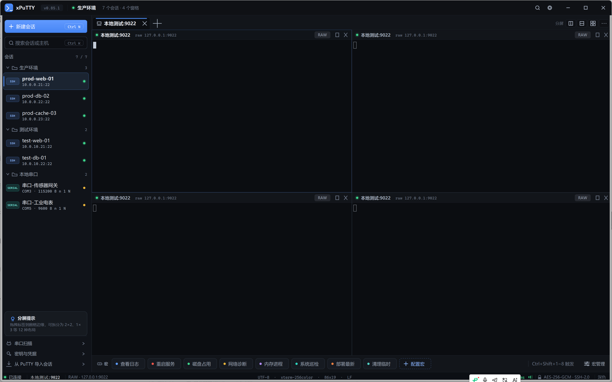
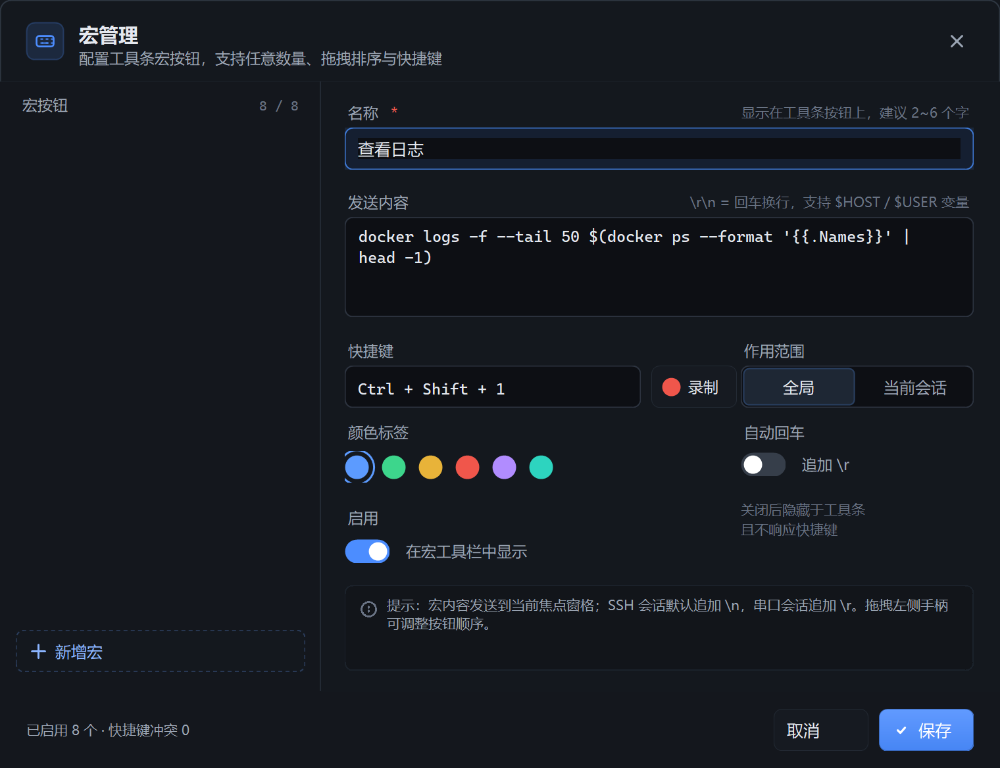
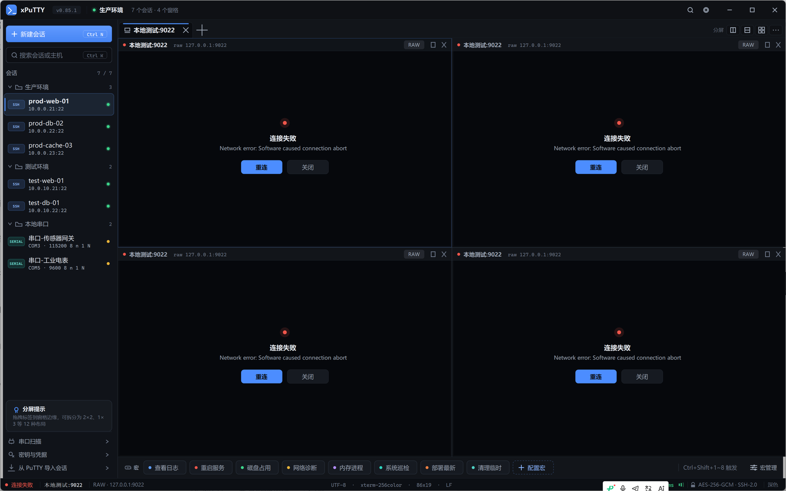

# xPuTTY

Windows 10/11 专用的 SSH / 串口终端管理器：**基于 PuTTY 0.85 源码改造** + 现代化自绘外壳。
面向经常用 MobaXterm 登录 SSH 和 COM 口的场景，解决它的两个痛点：

- **宏按钮只有 4 个** → xPuTTY 支持任意数量宏，工具条横向滚动，宏管理弹窗里可增删改、拖拽排序、设快捷键、选颜色、自动回车；
- **分屏只能横向 2 开** → xPuTTY 支持任意树形分屏（1x2、1x3、2x2、1+2、4+ 窗格），可分屏超过 4 个终端，也可多标签多开。

交付形式：**MSI 安装包**（x64，Program Files 安装，开始菜单 + 桌面快捷方式）。

**实际运行截图**（Windows 11 / 200% DPI）：






更多截图见 `docs/screenshots/`：单窗格、四窗格、三窗格、F11 最大化、宏管理、会话编辑、串口配置、设置。

## 功能

- 多标签（新建/关闭/拖动排序/中键关闭，Ctrl+Tab 切换）
- 任意分屏（纵向/横向切分、拖拽分隔条、F11 最大化窗格、布局预设）
- 宏系统：任意数量宏按钮、宏管理弹窗、快捷键、颜色标签、自动回车、`$HOST/$USER/$PORT` 变量
- 会话管理：分组/搜索/新建 SSH·Telnet·串口·Raw 会话/编辑/删除、从 PuTTY 导入现有会话
- 终端：完整 PuTTY 内核（SSH 密钥、Pageant、串口、复制粘贴、滚轮、256 色、窗口缩放）
- 深色主题，终端配色与外壳一致；断开显示遮罩并可一键重连
- 仅 Windows x64；.NET Framework 4.8（Win10/11 自带），无额外运行时依赖

## 目录结构

| 路径 | 说明 |
| --- | --- |
| `putty/` | PuTTY 0.85 fork。新增 `windows/xputty.c/.h`：嵌入模式、主题 INI、宏注入、热键转发、退出通知；`window.c`/`putty.c`/`CMakeLists.txt` 少量改动（见 `docs/PUTTY_FORK.md`） |
| `shell/` | C# WinForms 外壳（xputty.exe），Roslyn csc 编译，无需 .NET SDK |
| `installer/` | WiX 3.14 MSI 安装包定义 |
| `design/` | UI 设计稿（HTML 预览 + PNG）、设计 token、参考分析 |
| `docs/` | 架构/构建/测试/改造说明 |
| `build/` | 构建产物（不提交） |
| `dist/` | 最终 MSI（不提交） |
| `build-all.ps1` | 一键构建：PuTTY fork → 外壳 → MSI |

## 构建

前置：Windows 10/11 x64；Visual Studio 2022 BuildTools（MSVC + Windows SDK + 自带 CMake/Ninja/Roslyn csc）；WiX 3.14（已随项目放入 `tools/wix`）。

```powershell
# 一键构建（首次会完整编译 PuTTY，约 1 分钟）
powershell -ExecutionPolicy Bypass -File .\build-all.ps1

# 产物
dist\xPuTTY-1.0.0-x64.msi
```

单步：

```powershell
powershell -ExecutionPolicy Bypass -File .\build\build-putty.ps1 -SourceDir .\putty -Targets putty,plink
powershell -ExecutionPolicy Bypass -File .\shell\build-shell.ps1
```

## 安装 / 卸载

- 双击 `dist\xPuTTY-1.0.0-x64.msi` 安装（需要管理员确认，安装到 `%ProgramFiles%\xPuTTY`）。
- 卸载：设置 → 应用 → 已安装的应用 → xPuTTY。
- 用户数据保存在 `%APPDATA%\xPuTTY`（会话/宏/设置，卸载时保留）。
- 安装包**未做代码签名**，首次运行 SmartScreen 可能提示"更多信息 → 仍要运行"。

## 源码来源与许可

- `putty/` 基线为 **PuTTY 0.85** 官方源码（2026-08-16，`the.earth.li/~sgtatham/putty/latest/putty-0.85.tar.gz`）。GitHub 上的 `github/putty` 镜像停留在 0.74，因此以官方 tarball 为基线并导入本仓库 git。
- PuTTY 采用 MIT 许可（见 `putty/LICENCE`），xPuTTY 的修改与外壳同样以 MIT 发布，保留原作者版权声明。

## 已知限制

详见 `docs/TESTING.md`；主要包括：未签名、不支持自动更新、暂不支持浅色主题（规划 v1.1）、密码不入库（只保存用户名/私钥路径）。
